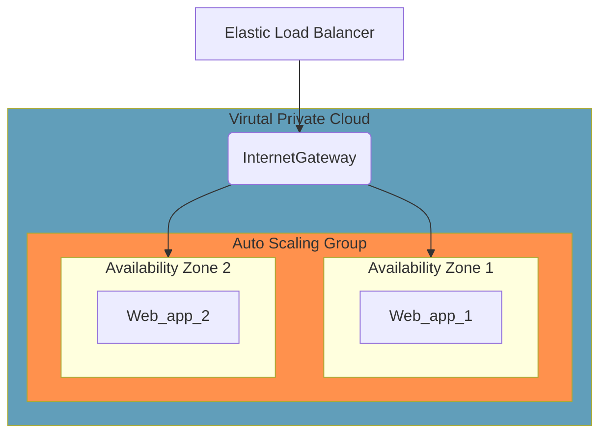

# AWS High available infrastructure using Terraform

## Purpose

We are using terraform to build an High Available infrastructure on AWS. We need:

* A load balanced Web App: [AWS Elastic Load Balancer](https://aws.amazon.com/fr/elasticloadbalancing/)
* An auto scaled Web App: [AWS AutoScaling Group](https://aws.amazon.com/fr/autoscaling/)
* 2 EC2 instances with apache installed, deployed on two separated Availability Zone (AZ)

## Infrastructure Diagram



## Network

[Terraform dedicated file](../tf-aws-infra/network.tf)

### VPC

A VPC (Virtual Private Cloud) gathers our AWS resources within a single virtual network to allow to communicate with each other and isolate them from other VPC.

In this VPC we can configure a range of IP addresses, subnets and routing tables

Here is our VPC:

```hcl
# VPC
resource "aws_vpc" "mike_vpc" {
  cidr_block = "10.0.0.0/16"
}
```

### Subnets

A subnet consits of a sub range of IP addresses from our VPC, 2 types available:
* Private
* Public

In this use case, public access is done through the ELB.

To make a subnet public we need to add an [Internet gateway](https://docs.aws.amazon.com/vpc/latest/userguide/VPC_Internet_Gateway.html) in front of it.

In addition our servers needs to access the internet to downloads packages for instance, so we need a [NAT Gateway](https://docs.aws.amazon.com/vpc/latest/userguide/vpc-nat-gateway.html)

*N.B: Main difference between Internet GW and NAT GW, is that the Internet GW allow both income and outcome traffic where NAT GW only allows outcome traffic*

Our subnets:

```hcl
# Subnets
resource "aws_subnet" "mike_public_subnets" {
  count = 2
  vpc_id                  = aws_vpc.mike_vpc.id
  cidr_block              = "10.0.${count.index}.0/24"
  availability_zone       = element(data.aws_availability_zones.available.names, count.index)
  map_public_ip_on_launch = true
}

data "aws_availability_zones" "available" {}
```

### Internet Gateway

An Internet Gateway in AWS is a horizontally scalable and highly available service that allows communication between instances in your Amazon Virtual Private Cloud (VPC) and the internet. It provides a route for traffic to flow from your VPC to the internet and vice versa. Internet Gateways can also serve as a target for public-facing resources' Elastic IP addresses.

```hcl
# Internet Gateway
resource "aws_internet_gateway" "gw" {
  vpc_id = aws_vpc.mike_vpc.id
}

```

### Route table

A routing table will filter traffic and, in this case, allow incoming traffic from the internet. This route table is associated to our sunets:

```hcl
# Route Table
resource "aws_route_table" "public_rt" {
  vpc_id = aws_vpc.mike_vpc.id

  route {
    cidr_block = "0.0.0.0/0"
    gateway_id = aws_internet_gateway.gw.id
  }
}

resource "aws_route_table_association" "public_association" {
  count          = 2
  subnet_id      = element(aws_subnet.mike_public_subnets.*.id, count.index)
  route_table_id = aws_route_table.public_rt.id
}

```

## ELB

[Terraform dedicated file](../tf-aws-infra/elb.tf)

### AWS Load balancer

An ELB, or Elastic Load Balancer, is a service in AWS that automatically distributes incoming network traffic across multiple servers to ensure high availability and reliability of your applications. It helps balance the load and handles sudden traffic spikes efficiently. You can choose from different types of ELBs based on your needs, like Application, Network, or Gateway Load Balancers. It’s a key component in scaling and optimizing web applications.

```hcl
# Load Balancer
resource "aws_lb" "my_lb" {
  name               = "mike-load-balancer"
  internal           = false
  load_balancer_type = "application"
  security_groups    = [aws_security_group.lb_sg.id]
  subnets            = aws_subnet.mike_public_subnets.*.id
}
```

### Target Group 

In the context of an Elastic Load Balancer (ELB) in AWS, a Target Group is a logical grouping of targets, such as EC2 instances, IP addresses, or Lambda functions, to which the ELB routes traffic. Targets within a group share the same routing configuration and health check rules. Each Target Group is associated with one or more listeners on the ELB, defining how incoming requests are distributed to the targets. It's a crucial component for managing and directing traffic efficiently

```hcl
resource "aws_lb_target_group" "my_tg" {
  name     = "my-target-group"
  port     = 80
  protocol = "HTTP"
  vpc_id   = aws_vpc.mike_vpc.id
}
```

### LB Listener

In an AWS Elastic Load Balancer (ELB), a listener is a process that checks for connection requests using a specified protocol and port. It defines how the ELB routes traffic to the target groups. For example, you can configure listeners for HTTP, HTTPS, or TCP, and set rules to determine which target group the request should be forwarded to based on conditions like URL patterns or host headers. Listeners are essential for managing traffic flow efficiently.

```hcl
resource "aws_lb_listener" "my_lb_listener" {
  load_balancer_arn = aws_lb.my_lb.arn
  port              = 80
  protocol          = "HTTP"

  default_action {
    type             = "forward"
    target_group_arn = aws_lb_target_group.my_tg.arn
  }
}
```

### LB Target group attachment

In the context of an AWS Elastic Load Balancer (ELB), a Target Group Attachment refers to the process of associating a specific target (e.g., EC2 instance, IP address, or Lambda function) with a Target Group. This attachment ensures that the ELB knows which targets within the group it can route traffic to. The health of these targets is monitored based on the configuration in the Target Group, ensuring only healthy targets receive traffic. It's an essential step in managing load balancing effectively

```hcl

resource "aws_lb_target_group_attachment" "web_targets" {
  count            = 2
  target_group_arn = aws_lb_target_group.my_tg.arn
  target_id        = aws_instance.web[count.index].id
  port             = 80
}

```

### Security group

As we did before, we need to configure SG

```hcl
# Security Group for Load Balancer
resource "aws_security_group" "lb_sg" {
  vpc_id = aws_vpc.mike_vpc.id

  ingress {
    from_port   = 80
    to_port     = 80
    protocol    = "tcp"
    cidr_blocks = ["0.0.0.0/0"]
  }

  egress {
    from_port   = 0
    to_port     = 0
    protocol    = "-1"
    cidr_blocks = ["0.0.0.0/0"]
  }
}
```

## EC2

[Terraform dedicated file](../tf-aws-infra/ec2.tf)

For EC2 configuration we are using what we have seen before:

```hcl
# EC2 Instances with Apache
resource "aws_instance" "web" {
  count         = 2
  ami           = var.AWS_AMIS[var.AWS_REGION]
  instance_type = var.INSTANCE_TYPE
  subnet_id     = element(aws_subnet.mike_public_subnets.*.id, count.index)
  security_groups = [aws_security_group.ec2_sg.id]
  user_data     = <<-EOF
            #!/bin/bash
            sudo apt-get update
            sudo apt-get install -y apache2
            sudo systemctl start apache2
            sudo systemctl enable apache
            echo "<html><body><h1>Hostname: $(hostname)</h1></body></html>" > /var/www/html/index.html
            EOF

}

# Security Group for EC2 Instances
resource "aws_security_group" "ec2_sg" {
  vpc_id = aws_vpc.mike_vpc.id

  ingress {
    from_port       = 80
    to_port         = 80
    protocol        = "tcp"
    security_groups = [aws_security_group.lb_sg.id]
  }

  egress {
    from_port   = 0
    to_port     = 0
    protocol    = "-1"
    cidr_blocks = ["0.0.0.0/0"]
  }
}
```

## Variables

[Terraform dedicated file](../tf-aws-infra/vars.tf)

We are defining default variables such as region and AMI

```hcl
variable "AWS_REGION" {
    type = string
    default = "eu-west-3"
    description = "EC2 instance region"
}

variable "AWS_AMIS" {
    type = map
    default = {
	"eu-west-1" = "ami-03fd334507439f4d1"
    "eu-west-2" = "ami-091f18e98bc129c4e"
    "eu-west-3" = "ami-06e02ae7bdac6b938"
    }
}

variable "INSTANCE_TYPE" {
  default = "t3.micro"
}
```

We also define hidden variables:
```hcl
variable "AWS_ACCESS_KEY" {}
variable "AWS_SECRET_KEY" {}
```

Which are declared in the `terraform.tfvars`:
```hcl
AWS_ACCESS_KEY="XXXXXXXXXXXXXXXXXXX"
AWS_SECRET_KEY="XXXXXXXXXXXXXXXXXXX"
```

## Deployment

### Plan and apply

Let's now try this infrastructure:

* terraform plan
```bash
> $ terraform plan
data.aws_availability_zones.available: Reading...
data.aws_availability_zones.available: Read complete after 0s [id=eu-west-3]

Terraform used the selected providers to generate the following execution plan. Resource actions are indicated with the following symbols:
  + create

Terraform will perform the following actions:

  # aws_instance.web[0] will be created
  + resource "aws_instance" "web" {
      + ami                                  = "ami-06e02ae7bdac6b938"
      + arn                                  = (known after apply)
      + associate_public_ip_address          = (known after apply)
...
```

* terrafrom apply
```bash
> $ terraform apply
data.aws_availability_zones.available: Reading...
data.aws_availability_zones.available: Read complete after 0s [id=eu-west-3]

Terraform used the selected providers to generate the following execution plan. Resource actions are indicated with the following symbols:
  + create

Terraform will perform the following actions:

  # aws_instance.web[0] will be created
  + resource "aws_instance" "web" {
      + ami                                  = "ami-06e02ae7bdac6b938"
      + arn                                  = (known after apply)
      + associate_public_ip_address          = (known after apply)
...
 Enter a value: yes
```

### Check our access to the web app

1. Get our ELB DNS:
   ```bash
  $ aws elbv2 describe-load-balancers --names mike-load-balancer --query 'LoadBalancers[0].DNSName' --output text
    
    mike-load-balancer-1625414563.eu-west-3.elb.amazonaws.com
   ```
2. Let's request this ELB
```bash
for i in {1..4}
do 
  curl http://$(aws elbv2 describe-load-balancers --names mike-load-balancer --query 'LoadBalancers[0].DNSName' --output text)
done

<html><body><h1>Hostname: ip-10-0-0-210</h1></body></html>
<html><body><h1>Hostname: ip-10-0-0-210</h1></body></html>
<html><body><h1>Hostname: ip-10-0-1-128</h1></body></html>
<html><body><h1>Hostname: ip-10-0-1-128</h1></body></html>
```

We can see both EC2 instances are responding !